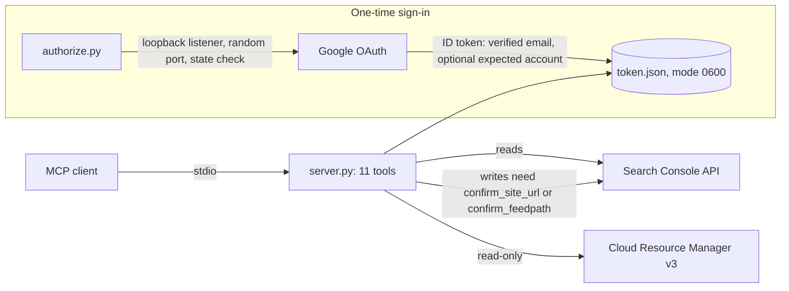

# kodros-search-console-mcp

An MCP server that lets an AI assistant read Google Search Console data and manage site properties and sitemaps. Every write needs the assistant to repeat the exact site URL or sitemap path back, so a vague request cannot delete the wrong thing.

Part of the [Kodros](https://kodros.ai) tooling for running product websites.

## On your hardware

- Does: lets an assistant manage Google Search Console. It has no local-inference part.
- Needs: Python 3.11. No GPU and no model.
- Not offline: it calls Google's Search Console and Cloud Resource Manager APIs with your credentials. The token is stored on your machine in a file with mode 0600.

## How it works



Static diagram: [docs/architecture.svg](docs/architecture.svg). Step-by-step build: [BUILD.md](BUILD.md).

Reads: list properties, search analytics by query, page, country, device or date, sitemap status, and URL inspection. Writes: add or remove a property, submit or remove a sitemap. Cloud project search and get are read-only. The sign-in script ignores any callback that lacks the OAuth `state` value and saves credentials only for a verified email.

## Stack

Python 3.11, FastMCP 3, google-api-python-client, google-auth-oauthlib, uv.

## Run

You need a Google Cloud project with the Search Console API and Cloud Resource Manager API enabled, and a Desktop OAuth client JSON.

```bash
uv sync
uv run python authorize.py --client-secret /path/to/client_secret.json --expected-email you@example.com
uv run python server.py
```

Register it as a stdio server: command `uv`, args `--directory /path/to/kodros-search-console-mcp run python server.py`.

Settings: the server reads `GOOGLE_API_MCP_TOKEN_FILE` and `GOOGLE_API_MCP_CLIENT_FILE`; both default under `~/.config/google-api-mcp/` (or `$XDG_CONFIG_HOME/google-api-mcp/`). `GOOGLE_API_MCP_ACCOUNT` is read only by `authorize.py`, as the default for `--expected-email`; the running server ignores it. `set-client-secret.py` updates the client JSON after you rotate the secret.

## Status and limits

- Version 0.1.0. No test suite yet. A smoke check confirmed the 11 tools register and the email check passes, matches and rejects against a stubbed Google flow. Live API calls were not run against a real account in this repo.
- Scopes: `webmasters`, `cloud-platform.read-only`, `openid`, `userinfo.email`.
- Removing a property removes it from your Search Console account, not from your website.
- It calls Google with your credentials. Review each write before an assistant runs it.

## License

Copyright 2026 Tanner Osterkamp. All rights reserved. See [LICENSE](LICENSE). The source is public to read; ask before reuse.
